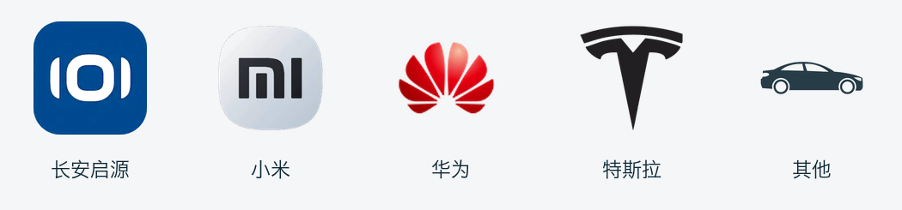

<p align="center"></p>
<h1 align="center">月账 · Yuezhang</h1>
<p align="center">日常记账 · 本地截图识别 · 订阅支出 · 钱包余额</p>
<p align="center"><a href="https://github.com/ives-cheung/yuezhang/releases/download/v1.2.0-alpha.1/com.ives.money_20261018_002_Alpha.apk">下载 Android 安装包</a> · <a href="https://github.com/ives-cheung/yuezhang/releases/tag/v1.2.0-alpha.1">发布说明</a> · <a href="LICENSE">MIT License</a></p>

月账是一款面向手机竖屏的 Android 个人记账应用，包名为 `com.ives.money`。默认使用浅色界面。
Logo「星球盈余」将地球圆环、空间数据轨道和收支曲线融合在一起。

## 下载与安装

- **[下载 com.ives.money_20261018_002_Alpha.apk](https://github.com/ives-cheung/yuezhang/releases/download/v1.2.0-alpha.1/com.ives.money_20261018_002_Alpha.apk)**
- [查看安装包 SHA-256 校验值](https://github.com/ives-cheung/yuezhang/releases/download/v1.2.0-alpha.1/SHA256SUMS)
- [所有版本](https://github.com/ives-cheung/yuezhang/releases)

当前版本：**1.2.0 Alpha**，支持 **Android 8.0 / API 26 及以上**。
下载 APK 后在手机上打开安装。发布包为调试签名的 Alpha 构建；覆盖已有安装需要相同签名。

## 功能

### 日常记账

- 手动记录支出、收入、退款、转账、还款、充值和不计收支的流水。
- 按月份与日期查看流水、已记录净支出、收入及退款。
- 分类图标在日常流水、订阅与钱包中共用。
- 信用卡还款、账户转账和充值单独标记，默认不计入消费。
- 退款冲减净支出，可关联原支出，并检查关联退款总额。

### 截图批量导入

1. 打开 **日常记账 → 截图导入**。
2. 选择账单来源、截图所属年份和月份，再从相册多选截图。
3. 在手机本地识别金额、商家、日期、时间、支付方式及可识别的交易单号。
4. 在核对清单中修改条目、对照原图、补齐日期、选择要入账的记录。
5. 确认后批量入账。

支持微信、支付宝账单列表或详情截图的规则提取，并对长截图分段识别。
同一截图条目、交易单号以及同日同商家同金额的记录用于重复检查；疑似重复条目保留给用户核对。
不同版本的账单布局会影响识别效果，缺少日期或金额的记录需要手动补齐。
核对清单保存在本地，未确认的条目不会自动计入流水。

### 文字快记

输入多笔内容，以逗号、分号或换行分隔，例如：

```text
午饭28，停车10；收入工资8000
昨天 咖啡15.50
```

先生成核对清单，再确认入账。此功能使用本地规则解析，不依赖云端大模型或 API Key。

### 订阅支出

- 月付、半年付、年付。
- 半年付金额除以 6、年付金额除以 12，折算为月均预计支出。
- 展示未来 7 天即将扣费的项目。
- 日常流水记录实际发生的交易，订阅页面展示周期与预计支出；两者不会自动叠加成一笔消费。
- 日常流水可以关联对应订阅。

### 车贷品牌选择

名称或分类以 **车贷、汽车贷款、汽车分期** 开头时，表单会显示 **车辆品牌**。

目前支持 **长安启源、小米、华为、特斯拉、其他**。已有车贷默认保留长安启源；明确选择的品牌会随记录保存。
关联到车贷订阅的日常流水也可以共用所选品牌图标。
洗车、充电、加油、停车与通行费继续使用通用车辆图标。



### 钱包与应收账款

- 钱包余额由用户手动更新，不随记账流水自动扣减。
- 应收账款支持金额、备注、转账日期、相册凭证和收回状态。

## 本地数据与隐私

账单、原始截图、文字快记和识别结果在设备本地处理。中文 OCR 模型随 APK 打包。
本应用没有云端账户或上传账单接口，发布包不声明 `android.permission.INTERNET`。
选择截图通过系统相册选择器完成。

源码仓库不包含个人账单、截图备份、运行数据库或签名私钥。

## 从源码构建

环境：JDK 17、Android SDK Platform 35、Gradle Wrapper 8.13、Python 3（用于数据迁移检查）。
先配置 `ANDROID_HOME`，或使用 Android Studio 打开项目并配置本机 SDK。
首次构建需要下载 Gradle、Android 构建工具与 ML Kit 依赖。

```sh
./gradlew assembleDebug
./gradlew lintDebug
./tests/run-core.sh
```

构建产物位于 `app/build/outputs/apk/debug/app-debug.apk`。
自行构建会使用本机调试签名；仓库不提供发布包所使用的私钥。

## 源码结构

| 位置 | 内容 |
| --- | --- |
| `MainActivity.java` | 订阅、钱包、应收账款及共用图标组件 |
| `LedgerUi.java` | 日常流水、编辑表单及批量核对清单 |
| `LedgerDb.java` | SQLite 存储和数据升级 |
| `ScreenshotImporter.java` | 本地中文 OCR 与长截图分段识别 |
| `BillParser.java` | 截图与文字的账单规则解析 |
| `LedgerRules.java` | 去重、净支出及退款校验 |
| `CarBrand.java` / `CarBrandControl.java` | 车贷品牌规则和选择界面 |
| `tests/` | 核心逻辑与 SQL 升级检查 |

上述 Java 源文件位于 `app/src/main/java/com/ives/money/`。

## 许可

项目代码、文档和原创应用 Logo 使用 **[MIT License](LICENSE)**，允许使用、修改、分发和商业使用，保留许可中的版权声明即可。
第三方 SDK、模型和品牌图形保留各自原有权利，详见 [第三方说明](THIRD_PARTY_NOTICES.md)。
